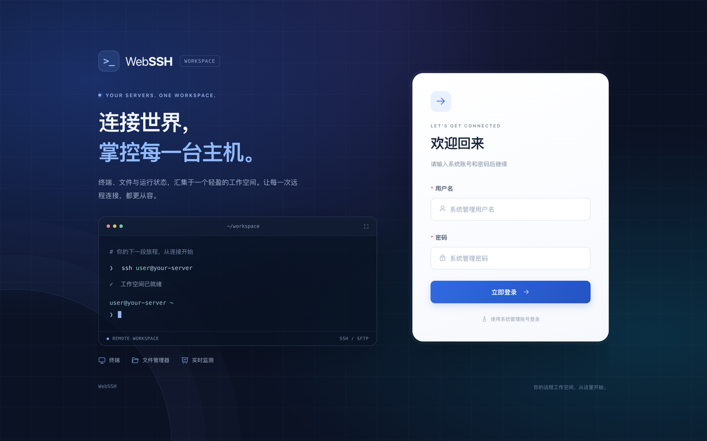
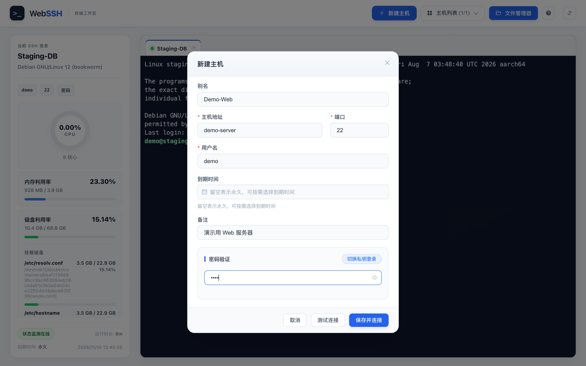
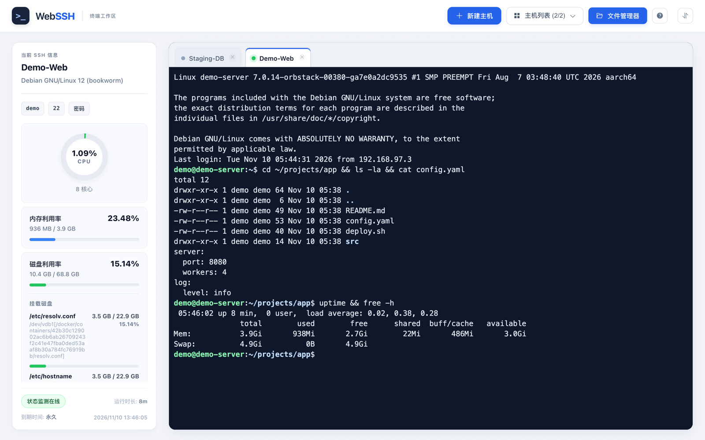
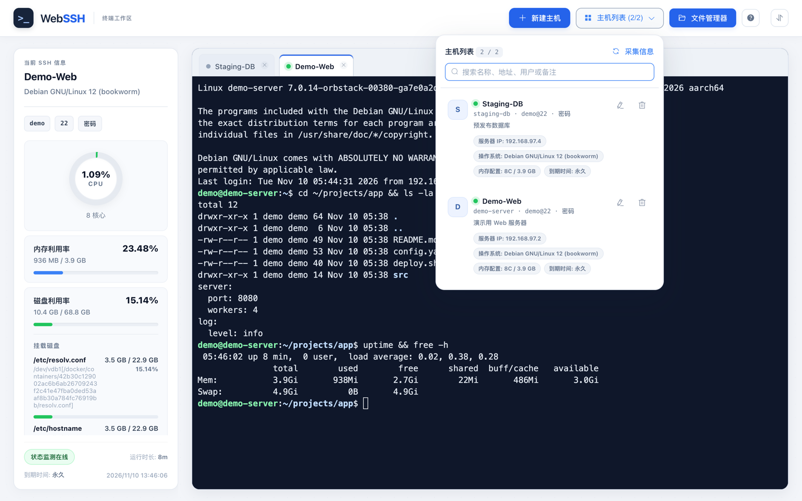
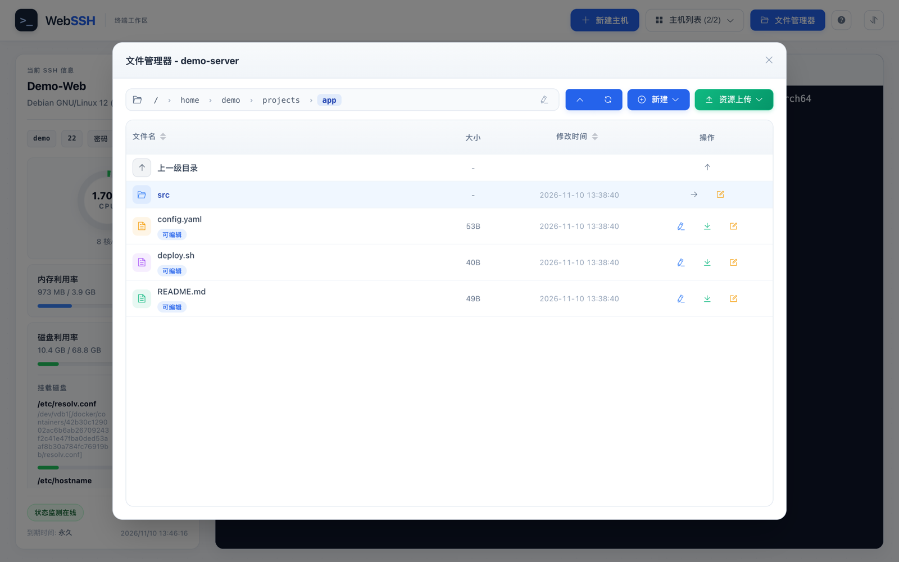
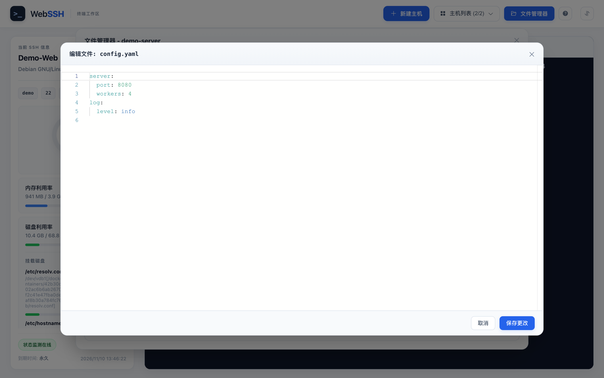

# WebSSH

[](https://www.gnu.org/licenses/gpl-3.0.en.html)

基于 Go + Vue 2 的 Web SSH / SFTP 工具：浏览器终端、主机管理、文件浏览与在线编辑，前端打包后嵌入单个二进制。

## 截图

> 截图使用本地临时演示主机（Docker 容器 `demo-server` / `staging-db`）拍摄，不含真实服务器信息。

| 登录 | 新建主机 |
| --- | --- |
|  |  |
| **终端与状态监控** | **主机列表** |
|  |  |
| **文件管理** | **在线编辑** |
|  |  |

## 功能概览

- **浏览器终端**：基于 WebSocket + xterm.js，多标签页、ANSI 色彩、断线重连、快捷键。
- **主机管理**：保存 SSH 主机配置（可选加密存储），可为主机补充公网 IP、地区、系统、内存、到期时间等元数据。
- **文件管理**：SFTP 目录浏览、上传、下载、新建、删除，浏览器内编辑文本文件（`Ctrl+S` / `Cmd+S` 保存）。
- **基础监控**：CPU、内存、磁盘、系统信息与运行时长。
- **登录鉴权**：`-a user:pass` 或环境变量 `authInfo` 开启 Web 访问认证。
- **中英文界面**。

## 技术栈

| 层级 | 技术 |
| --- | --- |
| 前端 | Vue 2、Element UI、xterm.js |
| 后端 | Go、Gin、gorilla/websocket |
| 远程能力 | SSH、SFTP（golang.org/x/crypto/ssh、pkg/sftp） |

```
+---------+   http / websocket   +--------+     ssh / sftp     +------------+
| browser | <==================> | webssh | <================> | ssh server |
+---------+                      +--------+                    +------------+
```

## 快速开始：Docker Compose（推荐）

只需要 Docker 和 Docker Compose v2：

```bash
git clone <本仓库地址> webssh && cd webssh
cp .env.example .env          # 修改 WEBSSH_AUTH_INFO，建议同时设置 WEBSSH_SECRET_KEY
docker compose up -d --build
```

浏览器访问 `http://<宿主机>:5032/`。`docker-compose.yaml` 要求必须设置 `WEBSSH_AUTH_INFO`，避免无鉴权实例被直接暴露。

镜像特性：

- 多阶段构建（Node 构建前端 → Go 编译静态二进制 → Alpine 运行），最终镜像只包含一个二进制。
- 以非 root 用户（uid 10001）运行，compose 中默认只读根文件系统、丢弃全部 capability。
- 内置 `HEALTHCHECK`，探测 `/api/status`（该接口无需登录），并跟随 `port` / `basePath` 变量。
- 已保存的主机配置持久化在 `webssh-data` 卷（容器内 `/home/webssh/.config/webssh`）。

常用命令：

```bash
docker compose logs -f webssh
docker compose ps            # STATUS 中可看到 healthy
docker compose down          # 保留数据卷；加 -v 会一并删除已保存的主机
```

国内网络可在 `docker-compose.yaml` 的 `build.args` 中启用 `GOPROXY` / `NPM_REGISTRY` 镜像源。

### 仅用 Docker

```bash
docker build -f docker/Dockerfile -t webssh:local .

docker run -d --name webssh --restart unless-stopped \
  -p 5032:5032 \
  -e authInfo='admin:change-me' \
  -e WEBSSH_SECRET_KEY="$(openssl rand -hex 32)" \
  -v webssh-data:/home/webssh/.config/webssh \
  webssh:local
```

> 注意：`WEBSSH_SECRET_KEY` 用于加密已保存的主机配置，重建容器时必须使用同一个值，否则旧配置无法解密。上面的写法仅作示例，实际请把密钥固定保存下来。

多架构镜像：

```bash
docker buildx build --platform linux/amd64,linux/arm64 -f docker/Dockerfile -t <registry>/webssh:latest --push .
```

## 配置

命令行参数与环境变量等价，二者同时存在时命令行参数优先。

| 环境变量 | 命令行 | 说明 | 默认值 |
| --- | --- | --- | --- |
| `port` | `-p` | 监听端口 | `5032` |
| `authInfo` | `-a` | Web 登录账号，格式 `user:pass`；为空则不启用鉴权 | 空 |
| `basePath` / `BASE_PATH` | `-b` | URL 前缀，反向代理到子路径时使用，如 `/webssh` | 空 |
| `savePass` | `-s` | 是否允许保存 SSH 密码 | `true` |
| — | `-t` | SSH 会话超时（分钟） | `120` |
| `WEBSSH_SECRET_KEY` | — | 加密已保存主机配置的密钥（任意长字符串） | 空（明文存储） |
| `WEBSSH_PROFILE_FILE` | — | 主机配置文件路径 | 用户配置目录下 `webssh/ssh_profiles.json`（Linux 为 `~/.config/webssh/`） |
| `WEBSSH_STRICT_HOST_KEY` | — | 校验 SSH 主机指纹（`true` 时使用 known_hosts） | `false` |
| `WEBSSH_KNOWN_HOSTS` | — | known_hosts 路径 | `~/.ssh/known_hosts` |
| `WEBSSH_MAX_EDIT_FILE_BYTES` | — | 在线编辑允许的最大文件字节数 | `5242880`（5 MiB） |
| `TZ` | — | 时区 | 镜像内 `Asia/Shanghai` |

`docker-compose.yaml` 读取 `.env` 中的 `WEBSSH_*` 变量再映射为上表变量，完整示例见 [`.env.example`](.env.example)。

## 从源码构建（不使用 Docker）

依赖：Go 1.23+、Node.js 20+（已在 Node 22 上验证）、npm。后端通过 `go:embed` 嵌入 `web/dist`，所以必须先构建前端。

```bash
cd web
npm ci
npm run build
cd ..

go build -trimpath -ldflags="-s -w" -o webssh .
./webssh -a admin:change-me -p 5032
```

前端开发模式（代理到本地 5032 后端，端口 8257）：

```bash
cd web && npm run serve
```

## 测试

```bash
go test ./...
cd web && npm test
```

## 安全建议

- 公网部署务必开启 `authInfo`，并放在 Nginx / Caddy 等 HTTPS 反向代理之后。
- 保存密码时请设置 `WEBSSH_SECRET_KEY`；需要防中间人时开启 `WEBSSH_STRICT_HOST_KEY` 并挂载 known_hosts。
- 自行从源码构建镜像，不要使用来源不明的二进制或镜像。

## 隐私说明

- 主机信息面板会请求 [ipwho.is](https://ipwho.is) 查询被连接服务器公网 IP 的地理位置。
- 在线编辑器（Monaco）从 `cdnjs.cloudflare.com` 加载。

内网或离线环境中，这两项请求会失败，但不影响终端和文件功能。

## 致谢

本项目基于 [Jrohy/webssh](https://github.com/Jrohy/webssh) 二次开发，遵循 [GPL-3.0](https://www.gnu.org/licenses/gpl-3.0.en.html) 开源协议。
